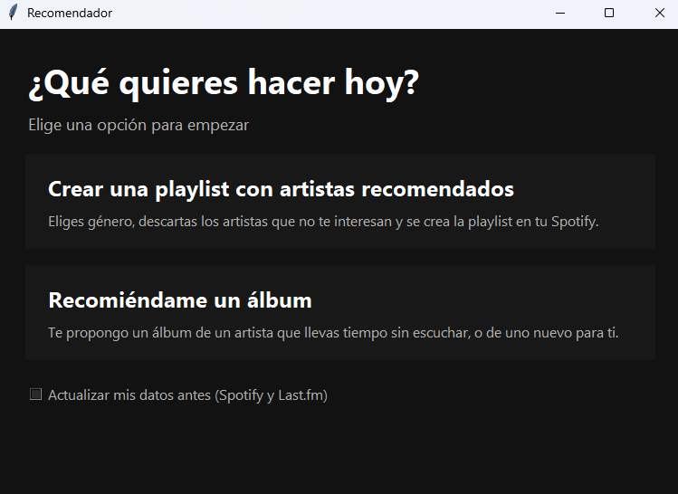
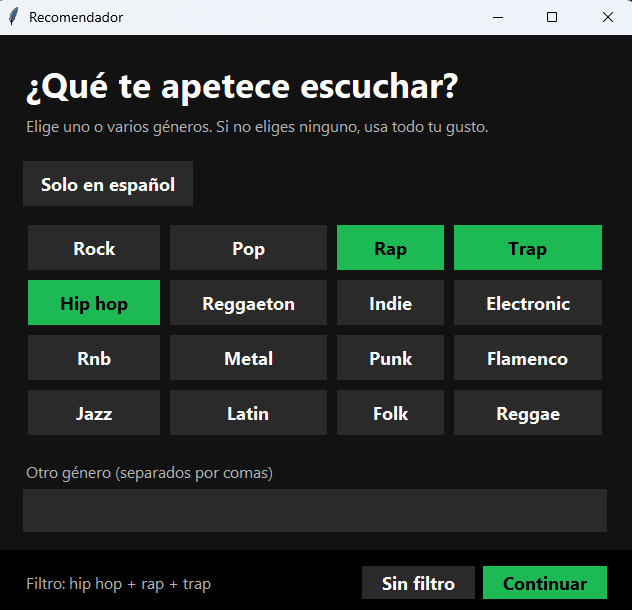
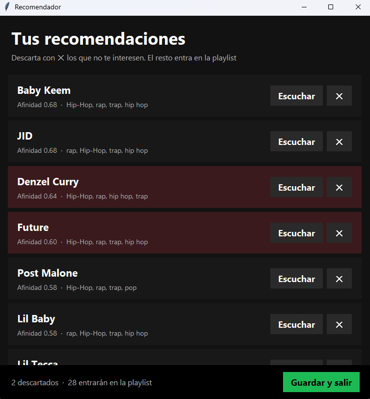
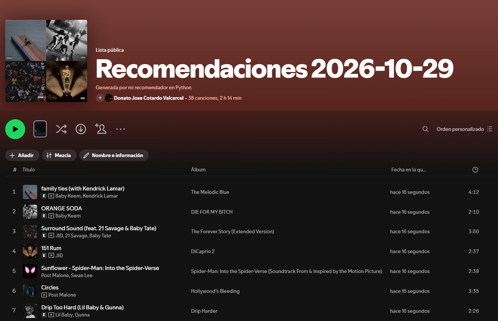
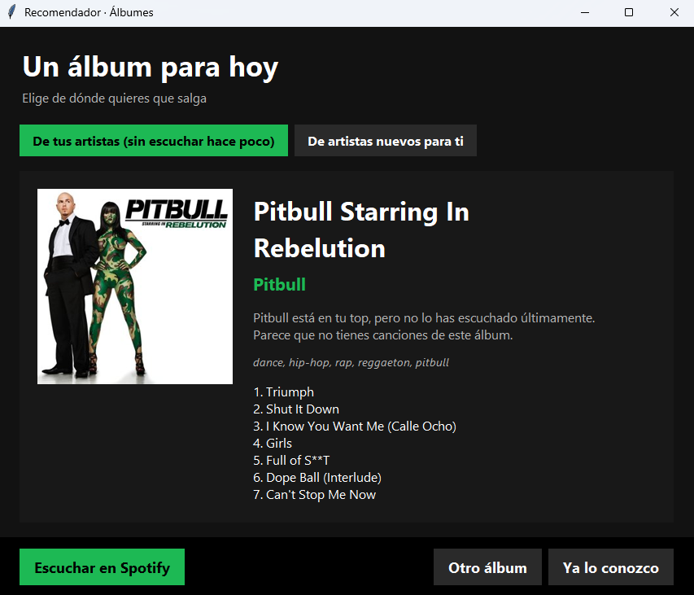

# Recomendador de música para Spotify

Recomendador personal de artistas, canciones y álbumes en Python. Analiza tu biblioteca de Spotify, enriquece los artistas con datos de Last.fm, te propone artistas nuevos según tu gusto y el género que te apetezca en ese momento, te deja descartar los que no te interesan y crea una playlist privada en tu cuenta. Además, puede recomendarte un álbum para escuchar hoy.

## Por qué existe este proyecto

Spotify ha ido recortando su API para apps nuevas: en noviembre de 2024 eliminó recomendaciones y audio features, y en febrero de 2026 retiró géneros y popularidad de los datos de los artistas y cambió los endpoints de playlists. Por eso este proyecto no pide recomendaciones a Spotify, sino que usa Spotify solo para leer tus datos y crear la playlist, y Last.fm para describir y relacionar artistas.

## Cómo funciona

1. Descarga tus canciones guardadas, tus tops (4 semanas, 6 meses, todo el tiempo) y tus escuchas recientes.
2. Para cada artista de tu biblioteca, pide a Last.fm sus etiquetas (rap, trap, rock...) y sus artistas similares.
3. Construye un perfil de tu gusto: un vector TF-IDF de etiquetas por artista, ponderado por cuánto lo escuchas.
4. Puntúa a los candidatos combinando dos señales:
   - **Vecinos:** cuántos de tus artistas favoritos tienen a ese candidato como similar.
   - **Contenido:** similitud de coseno entre las etiquetas del candidato y tu perfil.
5. Si eliges un género, amplía los candidatos con los artistas top de ese género y filtra por etiquetas.
6. Te muestra una ventana para descartar artistas.
7. Busca las canciones más populares de cada artista aprobado y crea la playlist.

## Nueva feature: recomendador de álbumes

Además de crear playlists, ahora el proyecto puede recomendarte **un álbum** para escuchar. No crea nada en tu cuenta de Spotify: elige el álbum con datos de Last.fm y un botón abre su búsqueda en Spotify para que lo escuches.

La ventana muestra la portada, el título, el artista, las etiquetas, la lista de canciones y el motivo de la recomendación. Tiene dos modos que se alternan con un clic:

- **De tus artistas (sin escuchar hace poco):** artistas de tu biblioteca que no aparecen en tus escuchas recientes ni en tu top de las últimas 4 semanas, y álbumes de los que no tienes canciones guardadas.
- **De artistas nuevos para ti:** artistas del último `recomendaciones_artistas.csv`, sin los que descartaste con ✕. Necesita haber ejecutado antes el flujo de playlist (o `python main.py --solo genero recomendar`).

Antes de recomendar el álbum puedes elegir uno o varios géneros, igual que en el flujo de playlists. El filtro se aplica a las etiquetas del álbum en Last.fm; también puedes elegir "Solo en español" o "Sin filtro".

Botones de la ventana:

| Botón | Qué hace |
|---|---|
| **Escuchar en Spotify** | Abre la búsqueda del álbum en Spotify |
| **Otro álbum** | Propone otro distinto (no repite los ya mostrados en la sesión) |
| **Ya lo conozco** | Lo guarda en `albumes_vistos.csv` y no vuelve a salir nunca |

Los artistas se eligen al azar, con más probabilidad para los que más escuchas, así que cada vez sale uno distinto. La búsqueda se hace en segundo plano y la ventana no se congela.

## Capturas

### Menú de inicio


<p>Menú principal de la aplicación con las opciones para crear una playlist recomendada o recibir una recomendación de álbum.</p>

### Elegir género


<p>Ventana para elegir un género musical.</p>

### Revisar artistas


<p>Ventana de revisión con tarjetas de artistas recomendados y botones para descartarlos o escucharlos en Spotify.</p>

### Playlist creada


<p>Playlist privada creada en Spotify con canciones de los artistas recomendados.</p>

### Recomendador de álbumes


<p>Ventana del recomendador de álbumes.</p>

## Estructura del proyecto

```
recomendador-spotify/
├── main.py
├── descargar_datos.py
├── lastfm.py
├── elegir_genero.py
├── recomendar.py
├── revisar_artistas.py
├── crear_playlist.py
├── recomendar_album.py
├── requirements.txt
├── .env
├── .gitignore
├── docs/
└── data/
```

## Scripts

| Script | Qué hace | Salida |
|---|---|---|
| `main.py` | Abre un menú para elegir entre crear una playlist o recibir un álbum, y ejecuta los scripts necesarios en orden. Se detiene si alguno falla. Permite saltar pasos o ejecutar solo algunos. | - |
| `descargar_datos.py` | Descarga de Spotify tus canciones guardadas, top canciones y artistas (3 periodos) y las últimas 50 escuchas. | `guardadas.csv`, `top_canciones.csv`, `top_artistas.csv`, `recientes.csv` |
| `lastfm.py` | Descarga de Last.fm las 15 etiquetas principales y 30 artistas similares de cada artista de tu biblioteca. Guarda el progreso y solo procesa artistas nuevos. | `artistas_tags.csv`, `artistas_similares.csv` |
| `elegir_genero.py` | Ventana para elegir géneros y la opción "Solo en español". Sin filtro, usa todo tu gusto. | `filtro.json` |
| `recomendar.py` | Calcula tu perfil, genera candidatos, aplica el filtro de género y puntúa. Excluye tus artistas y los que descartaste. | `recomendaciones_artistas.csv` |
| `revisar_artistas.py` | Ventana con tarjetas de artistas. Con ✕ descartas los que no quieres; los demás entran en la playlist. Incluye botón para escucharlos en Spotify. | `feedback.csv` |
| `crear_playlist.py` | Busca en Last.fm las canciones top de cada artista, las localiza en Spotify, quita las que ya tienes guardadas y crea la playlist privada. | Playlist en tu cuenta |
| `recomendar_album.py` | **Nuevo.** Ventana que recomienda un álbum con portada, lista de canciones y motivo. Aplica el género elegido a las etiquetas de Last.fm. Dos modos: artistas de tu biblioteca que llevas tiempo sin escuchar (sin canciones guardadas de ese álbum) o artistas nuevos recomendados. Botón para abrir el álbum en Spotify. | `albumes_vistos.csv` |

## Requisitos

- Python 3.9 o superior
- Cuenta de Spotify **Premium** (Spotify lo exige al dueño de la app en modo desarrollo)
- Cuenta de Last.fm con una API key
- `tkinter` (viene con Python en Windows y Mac; en Linux: `sudo apt install python3-tk`)
- `Pillow` para mostrar las portadas en el recomendador de álbumes (opcional: sin él la ventana funciona y muestra un ♪ en lugar de la portada)

## Instalación

1. Clona o descarga el proyecto y entra en la carpeta.

2. Crea y activa el entorno virtual:

```bash
python -m venv .venv

# Windows
.venv\Scripts\activate

# Mac/Linux
source .venv/bin/activate
```

3. Instala las dependencias:

```bash
pip install -r requirements.txt
```

## Configuración

### Spotify

1. Entra en https://developer.spotify.com/dashboard y pulsa **Create app**.
2. Marca **Web API** y usa esta Redirect URI (Spotify ya no admite `localhost`):

```
http://127.0.0.1:8888/callback
```

3. Copia el **Client ID** y el **Client Secret** desde Settings.

### Last.fm

1. Crea una API key en https://www.last.fm/api/account/create (callback y homepage pueden quedar vacíos).

### Archivo `.env`

Crea un archivo `.env` en la raíz del proyecto:

```
SPOTIPY_CLIENT_ID=tu_client_id
SPOTIPY_CLIENT_SECRET=tu_client_secret
SPOTIPY_REDIRECT_URI=http://127.0.0.1:8888/callback
LASTFM_API_KEY=tu_api_key
```

### `.gitignore`

```
.env
.venv/
venv/
data/
.cache
__pycache__/
```

`data/` contiene tus datos personales y `.env` tus credenciales. No los subas nunca a un repositorio.

## Uso

```bash
python main.py
```

Se abre un menú con dos opciones:

- **Crear una playlist con artistas recomendados:** elige género, descarta artistas y se crea la playlist en tu Spotify. Ejecuta: `descargar`, `enriquecer`, `genero`, `recomendar`, `revisar`, `playlist`.
- **Recomiéndame un álbum:** elige género y abre la ventana de álbumes. Ejecuta: `descargar`, `genero` y `album`.

Debajo de las opciones hay una casilla **"Actualizar mis datos antes"**. Viene marcada la primera vez (cuando aún no existe `data/guardadas.csv`) y desmarcada después. Si la desmarcas, se saltan los pasos de descarga y de Last.fm. En el modo álbum solo se refrescan tus escuchas, porque es lo que decide qué artistas llevas tiempo sin oír.

La primera vez, Spotify abrirá el navegador para pedirte permisos. Si la terminal pide pegar una URL, copia la de la barra de direcciones tras la redirección.

### Opciones de `main.py`

Los pasos son: `descargar`, `enriquecer`, `genero`, `recomendar`, `revisar`, `playlist`, `album`.

```bash
python main.py --modo playlist --saltar descargar enriquecer
python main.py --modo album
python main.py --solo revisar playlist
python main.py --solo album
python main.py --solo descargar
```

| Opción | Efecto |
|---|---|
| `--modo playlist` / `--modo album` | Salta el menú y ejecuta directamente ese flujo |
| `--saltar paso1 paso2` | Omite esos pasos |
| `--solo paso1 paso2` | Ejecuta únicamente esos pasos |

Uso habitual: la primera vez ejecuta todo; después, `--saltar descargar enriquecer` para obtener nuevas recomendaciones sin volver a bajar tus datos.

También puedes ejecutar cada script por separado con `python nombre_del_script.py`.

## Archivos generados en `data/`

| Archivo | Contenido |
|---|---|
| `guardadas.csv` | Tus canciones guardadas con artista, álbum y fecha |
| `top_canciones.csv` | Tus top canciones por periodo y posición |
| `top_artistas.csv` | Tus top artistas por periodo y posición |
| `recientes.csv` | Tus últimas 50 escuchas |
| `artistas_tags.csv` | Etiquetas de Last.fm por artista, con peso |
| `artistas_similares.csv` | Artistas similares de Last.fm con su grado de parecido |
| `filtro.json` | Último género elegido |
| `recomendaciones_artistas.csv` | Ranking de artistas recomendados con su puntuación |
| `feedback.csv` | Artistas que has descartado |
| `albumes_vistos.csv` | Álbumes marcados como "Ya lo conozco", para no recomendarlos otra vez |

## Ajustes

Estas constantes están al principio de los scripts:

| Constante | Script | Efecto |
|---|---|---|
| `N_CANDIDATOS_MAX` | `recomendar.py` | Máximo de candidatos que se consultan en Last.fm (más = más lento) |
| `UMBRAL_TAG` | `recomendar.py` | Peso mínimo de una etiqueta para que cuente en el filtro de género |
| `EXCLUIR` | `recomendar.py` | Nombres normalizados que nunca quieres ver (sellos, colectivos...) |
| pesos `0.6 / 0.4` | `recomendar.py` | Equilibrio entre vecinos y contenido (sin filtro). Con filtro se usa `0.3 / 0.7` |
| `N_MOSTRAR` | `revisar_artistas.py` | Artistas que se muestran en la ventana de revisión |
| `N_ARTISTAS` | `crear_playlist.py` | Artistas que entran en la playlist |
| `CANCIONES_POR_ARTISTA` | `crear_playlist.py` | Canciones de cada artista en la playlist |
| `MAX_PISTAS` | `recomendar_album.py` | Canciones que se listan en la tarjeta del álbum |

Si subes `N_ARTISTAS`, sube también `N_MOSTRAR` para revisar todos los que entran.

## Limitaciones conocidas

- **Playlists en modo desarrollo:** desde febrero de 2026 hay que usar `POST /me/playlists` y `POST /playlists/{id}/items`. Algunos desarrolladores siguen recibiendo un 403 incluso tras migrar. Si te pasa: borra el archivo `.cache`, comprueba que tu Premium está activo y, como alternativa, guarda las canciones en un CSV con enlaces y pega los enlaces en una playlist vacía desde Spotify de escritorio.
- **Historial corto:** Spotify solo devuelve las últimas 50 escuchas. Para un historial completo, solicita tus datos en Spotify (Cuenta > Privacidad > Descargar tus datos).
- **Calidad de las etiquetas:** depende de lo que la comunidad de Last.fm haya escrito. Artistas poco conocidos pueden tener etiquetas pobres.
- **Nombres de artistas:** Last.fm y Spotify escriben algunos nombres distinto. Se comparan normalizados (sin tildes, símbolos ni mayúsculas), pero puede haber excepciones.
- **Límites de la API:** Last.fm se consulta con pausas de 0,25 s para no saturarla, por eso `recomendar.py` tarda unos minutos.
- **Álbumes ya guardados:** "no tienes canciones de este álbum" se calcula comparando nombres de álbum de Spotify y Last.fm, que a veces difieren (ediciones deluxe, remasters). Por eso el texto dice "parece que no tienes".
- **Tipos de álbum:** Last.fm no siempre distingue álbumes, EPs, sencillos o recopilatorios, así que ocasionalmente saldrá alguno que no es un álbum "de verdad". El botón "Otro álbum" lo resuelve.
- **Modo "artistas nuevos":** refleja el último género que elegiste en la última ejecución de `recomendar.py`.

## Privacidad

Todo se ejecuta en tu equipo. Tus datos de Spotify se guardan solo en `data/` y las credenciales, en `.env`. Nunca compartas el Client Secret ni subas esas carpetas a GitHub.